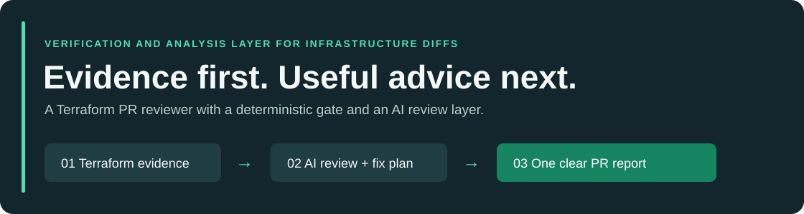
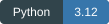
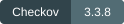

# V.A.L.I.D.

**Verification and Analysis Layer for Infrastructure Diffs**

An infrastructure reviewer that turns Terraform findings into a clear PR
verdict and a practical fix plan. Checkov and built-in rules supply the evidence;
NVIDIA Nemotron through Nebius Token Factory explains potential impact,
proposes next steps and identifies context a reviewer still needs to confirm.

**[Quickstart](#quickstart) · [AI review](#ai-review-with-nebius) · [PR workflow](#github-pull-request-reviews) · [Demo](docs/demo.md) · [Security](docs/security.md)**

## What the review gives you

| Question | V.A.L.I.D.'s answer |
|---|---|
| What needs attention? | A deterministic PASS / REVIEW / HIGH RISK / INCOMPLETE verdict |
| What should I fix first? | A fix plan ordered by detector priority, with matching detections grouped |
| Why does it matter here? | AI advice tied to the supplied resource, rule and evidence |
| What should I change? | Proposed actions, verification questions and reviewed Terraform attribute examples |
| Can I trace the claim? | Original detector findings, file locations and stable evidence IDs |

The AI adds review prose instead of copying a canned template. It reviews up to
**10 distinct issues** per scan; other issues retain basic guidance. Advice is
labeled **AI** or **basic** so you can tell what was generated. If the provider
is unavailable, the report explicitly shows basic guidance.

The deterministic engine owns the findings, verdict and exit code. AI advice
cannot change them, deploy infrastructure or merge a PR. No-key operation remains
available for offline review and provider outages.

## Quickstart

Use **Python 3.12**. Dependency installation requires internet access.

~~~sh
git clone https://github.com/Mukeshkr-19/V.A.L.I.D.git
cd V.A.L.I.D
python3.12 -m venv .venv
. .venv/bin/activate
python -m pip install -r requirements-lock.txt
python -m pip check
~~~

Try basic guidance first; this makes no model requests:

~~~sh
export VALID_AI_PROVIDER=disabled
DEMO_DIR=$(mktemp -d)

python -m valid scan --path fixtures/risky --output "$DEMO_DIR/risky"
echo "risky exit=$?"

python -m valid scan --path fixtures/fixed --output "$DEMO_DIR/fixed"
echo "fixed exit=$?"

cat "$DEMO_DIR/risky/comment.md"
~~~

| Fixture | Expected result | Exit |
|---|---|---|
| fixtures/risky | HIGH RISK: public SSH and disabled RDS deletion protection | 1 |
| fixtures/fixed | REVIEW: blocking built-in issues fixed; other Checkov findings remain | 0 |

**The risky command exiting 1 is expected.** The fixed example is REVIEW because
unmapped offline Checkov findings have unknown severity and need human review.
Neither command creates infrastructure. No cloud account or Terraform binary
is needed for this demo; Checkov is included in the dependency lock.

## AI review with Nebius

Configure the model in the same terminal as the scan. Use your account's exact,
case-sensitive model ID. Enter the key at the hidden prompt; never paste it into
chat, commit it or put it in a command saved to shell history.

~~~sh
export VALID_AI_PROVIDER=nebius
export VALID_AI_BASE_URL=https://api.tokenfactory.us-central1.nebius.com/v1
export VALID_AI_MODEL='nvidia/NVIDIA-Nemotron-3-Nano-30B-A3B'
unset VALID_AI_API_KEY
read -rs NEBIUS_API_KEY
export NEBIUS_API_KEY
printf '\n'

AI_DEMO=$(mktemp -d)
python -m valid scan --path fixtures/risky --output "$AI_DEMO/risky"
cat "$AI_DEMO/risky/comment.md"
~~~

Look for **AI-assisted review** and advice source labels. The origin field in
ai.json is **ai** for accepted generated advice and **template** for basic
guidance, unreviewed issues or template copies. HTTP success alone does not
establish useful generated advice.

For public SSH, the model can explain the potential attack surface, ask which
administration network is approved and suggest how to verify the restriction.
The fix plan supplies this reviewed attribute example:

~~~hcl
cidr_blocks = [var.approved_admin_cidr]
~~~

Define that variable from your approved network. The tool does not guess a
CIDR. Attribute examples are maintained product guidance, never model-generated
executable patches, and are never applied automatically.

The model receives bounded, redacted evidence summaries and source identities.
It does not receive raw Terraform, plans, state or repository instructions.
Responses must preserve exact finding/evidence references and evidence strength.
Specific unsupported identifiers and unsafe instructions are rejected. These
checks **do not prove every generated sentence true**: review proposed actions
against your actual environment. See the [security contract](docs/security.md).

| Variable | Purpose |
|---|---|
| VALID_AI_PROVIDER | nebius, openai_compatible, or disabled |
| VALID_AI_BASE_URL | Explicit HTTPS endpoint; Nebius accepts the regional URL above |
| VALID_AI_MODEL | Explicit model ID; no silent model substitution |
| VALID_AI_API_KEY | Generic key override; otherwise provider-specific key is used |
| NEBIUS_API_KEY / OPENAI_API_KEY | Provider-specific key |

Missing or invalid configuration makes no model call. Transport, deadline,
HTTP, parsing or validation failures produce basic guidance and leave the
deterministic verdict unchanged. After your session:

~~~sh
unset NEBIUS_API_KEY VALID_AI_API_KEY
export VALID_AI_PROVIDER=disabled
~~~

## Understand the verdict

| Verdict | Meaning | Exit |
|---|---|---|
| PASS | Completed analysis with no condition requiring review | 0 |
| REVIEW | Findings, unknown severity or optional coverage need review | 0 |
| HIGH RISK | Evaluated high/critical evidence matches a blocking policy | 1 |
| INCOMPLETE | Required analysis failed or required coverage is missing | 1 |

Precedence: INCOMPLETE → HIGH RISK → REVIEW → PASS. The numeric score is
informational. Missing Checkov, malformed Terraform or required scanner failures
cannot silently produce PASS.

Built-in checks cover public IPv4 SSH (DG-AWS-NET-001), explicitly disabled
RDS deletion protection (DG-AWS-RDS-001) and missing/empty owner/environment
tags on supported AWS resources (DG-AWS-TAG-001). The packaged policy maps
Checkov's CKV_AWS_24 and CKV_AWS_293 to blocking high priority. Other offline
Checkov failures retain unknown severity and warn policy.

## Scan your Terraform

~~~sh
python -m valid scan --path infra --output out/review-1
~~~

Choose a **new or empty output directory** for each run, outside the scanned
tree and without symbolic links. The scanner reads static source only: it does
not run Terraform, resolve your entire deployment, read state or know whether
a resource is being created, changed or destroyed (change_action: unknown).
Unresolved values are visible coverage gaps. IPv6 exposure is outside the
built-in SSH rule.

## GitHub pull-request reviews

The included valid.yml scans **infra/ from the PR head** with reviewer code
from the trusted base commit. It publishes a sticky PR comment, job summary,
downloadable artifacts and a deterministic check result. Revisions update the
same comment when permissions allow. Fork comments may be unavailable.

**PR scans currently produce basic guidance.** The scanner strips credential
variables and the included workflows contain no model key. The separate
AI-enrichment helpers are not wired into a privileged workflow. Enabling that
automation requires a reviewed default-branch workflow and explicit secret
configuration; putting a key in the untrusted scanning job is unsafe.

Set a required status check in branch protection if you want failing verdicts
to block merges. Workflow-file changes require human review. See
[the demonstrated PR lifecycle](docs/demo.md#3-draft-pull-request-demo).

## Artifacts and architecture

~~~text
Terraform source → Checkov + built-in rules → normalized findings
                                            ↓
                                   deterministic risk verdict
                                            ↓
                              evidence-linked AI review / basic guidance
                                            ↓
                                fix plan + report + six artifacts
~~~

| File | Contents |
|---|---|
| comment.md | Verdict, review mode, grouped fix plan and detector evidence |
| summary.json | Deterministic status, score, counts and coverage |
| findings.json | Detector-owned findings, resource locations and stable IDs |
| raw_checkov.json | Minimized, sanitized, canonically ordered scanner records |
| raw_custom.json | Built-in findings and parser coverage |
| ai.json | One explanation per finding, exact references and advice origin |

Normal publication writes all six together and rolls back only files created
by that run on failure. Basic-mode fixture runs repeat byte for byte. Generated
advice can vary across provider calls; deterministic findings and summary do not
depend on that prose. Grouping the fix plan does not remove detector findings.

## Development and verification

With Node.js on PATH for workflow-script tests:

~~~sh
export VALID_AI_PROVIDER=disabled
python -m pytest tests -q -p no:cacheprovider -rs
~~~

Install actionlint to include workflow linting; its optional test skips when
the binary is unavailable. The CLI itself needs neither Node nor actionlint.
The wheel includes the policy and process-isolated transport helper. Dependency
versions are pinned in requirements-lock.txt, but downloads are not hash-pinned.
Windows behavior is unverified.

An [earlier synthetic live receipt](docs/demo.md#live-verification-receipt)
verified Nebius serving the exact NVIDIA model on October 12, 2026 UTC.
That receipt used the previous template-copy contract; it does not prove the
new generated-advice behavior or live AI in GitHub jobs.

**[Demo guide](docs/demo.md) · [Security and limitations](docs/security.md) · [MIT license](LICENSE)**
